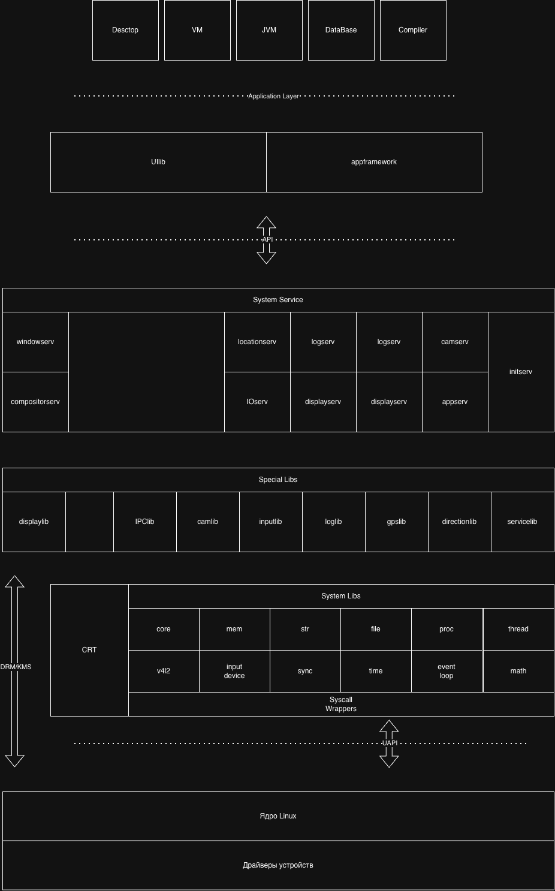

# PUNos

PUNos — собственная userspace-платформа, работающая поверх **неизменённого
upstream-ядра Linux** (6.12.111 LTS, x86_64) и запускаемая в QEMU. От Linux
берётся только ядро: glibc, systemd и привычного дистрибутивного userspace
здесь нет. Каждый нативный компонент — статический freestanding ELF, собранный
на собственных CRT и слое системных вызовов PUNos.

Цель проекта — построить весь путь от первого процесса до приложений своими
силами: `/init` → системные библиотеки → системные сервисы → фреймворк
приложений и UI.



## Слои и текущее состояние

| Слой | Что это | Состояние |
| --- | --- | --- |
| Ядро Linux | Зафиксированная версия и эталонный конфиг, исходники скачиваются сценарием | Готово |
| Syscall Wrappers | Минимальный системный ABI: вызовы через инструкцию `syscall`, thread-local `errno`, без libc и vDSO | Готово |
| CRT | `_start`, настройка TLS, вызов `main()` и выход | Готово |
| Boot | `/init` (PID 1) и воспроизводимый initramfs | Готово |
| System Libs | `libcore`, `libmath`, `libmem`, `libstr`, `libfile`, `libtime`, `libprocess`, `libthread`, `libsync`, `libeventloop`, `libinputdevice`, `libv4l2` | Готово |
| Special Libs | IPC, журналы, камера, устройства ввода, дисплей | Спецификации |
| System Services | `initserv`, `logserv`, `appserv`, `IOserv`, `camserv`, `locationserv`, UI-серверы | Спецификации |
| Application Layer | `appframework`, `uilib` | Спецификации |

Сейчас на месте `initserv` стоит smoke-test заглушка: при загрузке она по
очереди запускает self-test'ы Syscall Wrappers и всех System Libs и печатает
результат каждого.

## Быстрый старт

Нужен x86_64-компьютер с Debian 13 или Ubuntu, около 4 ГиБ свободного места
и пакеты из [руководства](System/start-guide.md#требования). Из корня
репозитория, **без `sudo`**:

```bash
./System/scripts/prepare-kernel.sh      # скачать и проверить исходники ядра
./System/scripts/build-kernel.sh        # собрать bzImage
./System/scripts/build-initramfs.sh     # собрать userspace и initramfs
./System/scripts/run-qemu-initramfs.sh  # загрузить PUNos (выход: Ctrl+A, затем X)
```

При нелатинской локали запускайте сборку initramfs как
`LC_ALL=C ./System/scripts/build-initramfs.sh`.

Успешная загрузка заканчивается строками `PUNos initserv stub: <имя>
self-test passed` для каждого теста. Проверить загрузку без ручного просмотра
журнала можно командой `./System/scripts/check-qemu-boot.sh`.

Тесты на хосте, без QEMU:

```bash
make -C System/NativeRuntime/SyscallWrappers check
make -C System/NativeRuntime/CRT check
make -C System/SystemLibs check
```

## Структура репозитория

```text
.
├── DevDoc/                 # спецификации всех слоёв (хранилище Obsidian)
├── System/
│   ├── start-guide.md      # полное руководство по сборке и запуску
│   ├── kernel/             # версия, SHA256 и конфиг ядра
│   ├── scripts/            # подготовка, сборка, запуск и проверка в QEMU
│   ├── NativeRuntime/      # Syscall Wrappers и CRT
│   ├── SystemLibs/         # System Libs
│   └── Boot/               # /init и заглушка initserv
└── .github/workflows/      # CI: тесты, initramfs, ядро, загрузка в QEMU, релизы
```

## Документация

- [System/start-guide.md](System/start-guide.md) — сборка, запуск, проверки и
  типичные ошибки.
- [DevDoc/](DevDoc/) — спецификации. Они являются контрактом: реализация
  обязана им соответствовать. Начать удобно со
  [списка System Libs](DevDoc/SystemLibs/_LibsList.md),
  [списка Special Libs](DevDoc/SpecialLibs/_LibsList.md) и
  [списка System Services](DevDoc/SystemServices/_ServList.md).
- [System/SystemLibs/README.md](System/SystemLibs/README.md) — соглашения
  для библиотек и чек-лист добавления новой.

Документация и спецификации пишутся на русском, код, комментарии и README
компонентов — на английском.

## CI и релизы

GitHub Actions (`.github/workflows/ci.yml`) на каждый push и pull request
прогоняет тесты, проверяет воспроизводимость initramfs, собирает ядро и
загружает образ в QEMU. Push тега `v*` публикует GitHub Release с `bzImage`,
initramfs и контрольными суммами.
